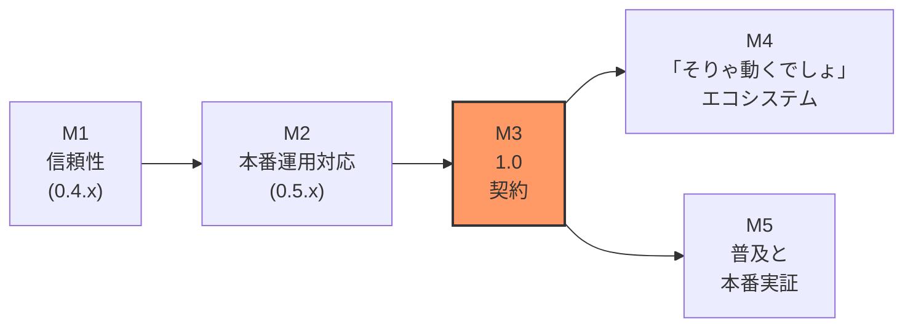

> 🇬🇧 English version: [ROADMAP.md](ROADMAP.md)

# homura ロードマップ

**北極星: Cloudflare Workers で Ruby が動くことが「当たり前」に感じられること。**

いまはまだ「エッジで Ruby」は曲芸に見える。このロードマップが目指す
終着点はその真逆で、Ruby 開発者が「本番の Sinatra は Cloudflare Workers
で動かしてます」と聞いて肩をすくめる状態 — *そりゃそうでしょ* —
である。以下のマイルストーンはすべて、「見て、動いた！」と
「動かない理由ある？」の間のギャップを埋めるために存在する。

[README](README.ja.md) には現在 **「本番投入はまだしないでください」**
のバナーがある。この文書は、そのバナーを削除するための — そして削除が
何のドラマにもならないようにするための — 計画である。

---

## 現在地（2026-07 スナップショット）

直近の履歴が語っていること:

- **6 つの gem が RubyGems から配布中**（GitHub Actions Trusted
  Publishing 経由）— `opal-homura` 1.8.3.rc1.5、`homura-runtime` 0.3.35、
  `sinatra-homura` 0.3.2、`sequel-d1` 0.3.1、`sinatra-inertia` 0.1.5、
  `sinatra-kagero` 1.0.2。`path:` 参照はゼロで、[`examples/`](examples/)
  は公開済み gem のみを使う。
- **17 個のスタンドアロン example**、大半が `*.kazu-san.workers.dev` に
  ライブデプロイ済み。Rack、classic/modular Sinatra、D1（Sequel あり /
  なし）、Email、OTP 認証、Inertia、Hotwire、Phlex、Workers AI
  （チャット / 文字起こし / 音声対話）、Durable Objects、そして
  [Kagero](gems/sinatra-kagero/) フルスタックまでをカバー。
- **Kagero 1.0 が着地**: Ruby 流の Inertia レイヤー — Phlex ページ、
  Literal props、`Kagero::Command` によるフォームモデリング — を
  ユーザーランド JavaScript ゼロで実現。
- **非同期は見えない**: auto-await ビルドパスがユーザーソースを同期形の
  ままに保つ。内部表現（`__await__` など）はポリシーとしてあらゆる
  公開面から隠蔽されている。
- **痛みも見えている**: Phlex/Literal を Opal 上で動かすのに
  homura-runtime 0.3.9 → 0.3.35 — 公開 gem ビルドに対する
  「publish → 壊れる → patch」を 1 日で 27 リリース繰り返した。
  このループこそが、homura と「退屈さ」の間に立つ最大の障害である。

---

## M1 — 信頼性: publish-break-patch ループを殺す（`0.4.x`）

*ゴール: リリースが退屈であること。壊しうるものはすべて CI が先に走らせているから。*

0.3.9–0.3.35 の連打は、スモークスイート（`npm test`）が問題を公開の
**後に**捕まえていることを証明した。スイートはモノレポの中で走るため、
ユーザーが実際に体験すること — RubyGems からパッケージ済み gem を
インストールし、それに対してスタンドアロンなアプリをビルドする — を
一度も検証していない。gem パッケージングの抜けや load path の暗黙の
前提は、公開後に初めて表面化した。しかもこのループは**構造的に**高く
つく: repo ポリシーは（正しくも）examples での `path:` 参照と tag の
再利用を禁じているので、公開パッケージングを検証できる唯一の環境が
本物の RubyGems リリースだった — 1 修正 = 1 バージョン bump、が 27 回。
答えはポリシーを緩めることではなく、公開環境を CI でシミュレートする
こと。M1 は examples とスモークテストを「リリース後の警報」から
「リリース前のゲート」に変える。

- **公開面ビルドマトリクスを CI に。** すべての PR で、全 example を
  ローカルビルドした `.gem` セット（リリースワークフローが push するのと
  同じ成果物）に対してビルドする。「RubyGems から入れて動く」を
  RubyGems を往復せずに検証する。tag push 時は実レジストリに対して
  再検証してから完了を宣言する。
- **vendored gem 互換ハーネス。** Sinatra / Rack / Sequel / Phlex /
  Literal / Zeitwerk のバージョンを単一マニフェストにピン留めし、
  定期ジョブが各 gem を試験的に bump して全スイートを走らせる —
  upstream のドリフトは「ユーザーのバグ報告」ではなく「落ちる PR」に
  なる。
- **Opal fork 戦略。** `opal-homura` は rc バージョンのパッチ済み
  fork。upstream Opal との正確な差分を
  [`docs/VENDOR_PATCHES.md`](docs/VENDOR_PATCHES.md) に文書化し、
  upstream に送れるものは送り、送れないものは non-rc リリースを切る。
- **Ruby の形をした失敗。** Worker がクラッシュしたとき、開発者が見る
  べきはコンパイル済み出力への V8 スタックではなく `app.rb:12` を指す
  Ruby バックトレース。source map によるバックトレース書き換えを、
  まず `wrangler dev`、次に本番ログで。
- **`homura doctor`。** Ruby/Node/wrangler のバージョン、gem ピンの
  整合性、`wrangler.toml` の形、binding 宣言をチェックして、何が
  おかしいかを正確に言うコマンドを 1 つ。

**完了条件:** 「公開ビルドとモノレポビルドの差」起因の追い patch
リリースがゼロの gem リリースが 2 回連続で成立すること。

---

## M2 — 本番運用対応（`0.5.x` → `1.0.0.rc`）

*ゴール: 「で、実際に運用できるの？」への答えが、文書化された Yes であること。*

- **可観測性。** 構造化リクエストログを標準装備。例外レポートフック
  （プラガブル — Sentry 互換エンドポイントまたは Workers Analytics
  Engine）。Ruby の例外が読める形で届く `wrangler tail` ワークフローの
  文書化。
- **数字を公開する。** ライブサイトに CI で再生成されるベンチマーク
  ページ: コールドスタート時間、example ごとのバンドルサイズ、
  同等のプレーン JS Worker と比較した p50/p99 レイテンシ。
  Ruby-on-Workers を「気持ち」の話から卒業させる。
- **バンドル規律。** example ごとのサイズバジェットを CI で強制し、
  未使用の stdlib / vendored コードパスのデッドコード除去を進める。
  最小アプリ（`todo-simple`）がカナリア。
- **セキュリティ面。** 暗号化セッションクッキーの一級サポート、
  フォーム POST example 向けの CSRF ヘルパー、「secret は wrangler に、
  ソースには置かない」を scaffold のデフォルトに — それぞれレシピ付き。
- **運用ガイド。** 正直な文書を 1 本: Workers の CPU 時間制限、
  バンドルサイズ制限、subrequest 制限、D1 の一貫性モデル、homura が
  その上に足しているもの、そして各制限がどう噛みつき、どう緩和するか。
  本番の自信は、エッジケースを隠すことではなく知っていることから来る。
- **アプリのテストストーリー。** `homura new` が、CRuby で走る
  rack-test 流ユニットテスト（速い、ビルド不要）と、`wrangler dev` に
  対するワンコマンド e2e タスクを scaffold する — `auth-otp` が既に
  証明しているパターンをデフォルトにする。

**完了条件:** [`site/`](site/) と、実トラフィックのあるサービス最低
1 つが、ロギング・エラーレポート・運用ガイドを自分自身に適用した状態で
`1.0.0.rc` の gem 上で動いていること。

---

## M3 — 1.0: 契約

*ゴール: README バナーが今否定していることを、バージョン番号が肯定すること。*

- **公開面の凍結**: CLI（`homura new` / `build` / `db:*`）、scaffolder
  レイアウト、binding ヘルパー名（`db`、`d1`、`kv`、`bucket`、`ai`、
  `send_email`、`durable_object`、…）、Kagero の page/command API、
  そして `build/worker.entrypoint.mjs` という契約。
- **semver + 非推奨化ポリシー。** 1.0 以降、破壊的変更は major bump と
  非推奨化サイクルを伴う。（1.0 までは repo ポリシーどおり意図的に
  容赦なく — 途中に互換 shim は作らない。）
- **ロックステップ 1.0** — homura-runtime / sinatra-homura / sequel-d1 /
  sinatra-inertia を揃えて上げ、単一の互換表を持つ: gem セット ↔
  サポートする `compatibility_date` 範囲 ↔ Ruby バージョン。
- **バナーを消す。** 「本番投入はまだしないでください」を、サポート
  構成の宣言に置き換える。これがすべての目的。

**完了条件:** バナーが消えていること。そしてその削除に信仰の飛躍が
不要だったこと — README のすべての主張が CI かライブデプロイに
裏打ちされている。

---

## M4 — 「そりゃ動くでしょ」エコシステム（1.0 以降）

*ゴール: 「X は homura で動く？」へのデフォルトの答えが、検証可能な Yes であること。*

- **gem 互換ゲージ。** スモークスイートが実際に動かしている gem
  （`jwt`、`faraday`、`octokit`、`phlex`、`literal`、`sequel`、…）を
  リリースごとの pass/fail 付きで一覧する、自動生成のライブページ。
  このリストを育てること自体を明示的な継続ワークストリームにする —
  新しく green になる gem の一つひとつが「へえ、普通に動くんだ」の
  積み増しになる。
- **プラットフォーム全面カバー。** binding は既に D1 / KV / R2 / AI /
  Queues / Scheduled / Durable Objects / Vectorize / Email に及ぶ。
  Workflows、Hyperdrive（Sequel 経由の本物の Postgres — `sequel-d1` の
  アダプタ設計は一般化できる）、Durable Objects 上の WebSocket、
  rate limiting、Browser Rendering へ拡張する — それぞれデプロイ済み
  example 付きで。[`examples/`](examples/) が契約だから。
- **Kagero をフラッグシップに。** ガイド、より豊かなバリデーションの
  エルゴノミクス、partial reload パターン、そして非自明な
  リファレンスアプリ。「下から上まで Ruby、ユーザーランド JS なし」の
  ピッチは todo リストより大きなショーケースに値する。
- **agent-workspace → 本物のエージェントへ。** `agent-workspace`
  （Durable Objects + R2 のシェル）を、約束していた AI エージェント
  example に育てる: エッジ上で Ruby がオーケストレーションする
  長時間稼働エージェント。

---

## M5 — 普及: 当たり前にする

*ゴール: 当たり前感 — 「Ruby のデプロイって今はこうやるんだよ」という空気。*

「普通であること」はエンジニアリングの問題であると同時に流通の問題である。

- **成功を前提にしたドキュメント。**
  [homura.kazu-san.workers.dev/docs](https://homura.kazu-san.workers.dev/docs)
  をリファレンスからガイドへ拡張する: 「10 分で Sinatra をエッジへ」、
  binding ごとのクックブック、「Rails 開発者のための Workers 地図」。
- **ゼロからデプロイまでのテンプレート。** Deploy-to-Cloudflare ボタンと
  examples 由来のスターターギャラリー。最初の成功体験が数分で、
  clone なしで手に入るように。
- **本番での証明。** `*.kazu-san.workers.dev` の dogfood 群の
  稼働率・レイテンシを公開し、実サービスのケーススタディを書く —
  ダッシュボード付きの主張。
- **物語を語る。** マイルストーンごとの日英の記事、ベンチマーク記事、
  RubyKaigi 周辺での可視性。狙う反応は「すごい」ではなく
  「へえ、週末に試してみよ」。
- **エージェントネイティブな流通。** `llms.txt` と
  [`skills/homura-workers-gems/`](skills/homura-workers-gems/) を
  リリースごとに最新に保つ。開発者が AI アシスタントに「Cloudflare で
  Ruby 動く？」と聞いたとき、アシスタントが「動くよ、homura を使って、
  コマンドはこれ」と答えること — それこそが機械化された当たり前感。

---

## やらないこと

プロジェクトの設計ポリシーから引き継ぐガードレール:

- **Rails ポートはしない。** 表面は Ruby / Rack / Sinatra（+ その上の
  Kagero）。広さより深さ。
- **非同期の儀式は永遠に出さない。** `__await__` 系の内部表現は
  ユーザーコード・ドキュメント・example に出さない。特別な書き方が
  必要なイディオムがあれば、それは教えるべき慣習ではなく homura が
  吸収すべきバグ。
- **1.0 前の互換 shim は作らない。** 驚き最小の基準を満たさない
  surface は、alias ではなく置き換える。
- **SLA ごっこはしない。** M2 の可観測性と運用の仕事が本物の主張を
  可能にするまで、ライブデモは正直な dogfooding フィクスチャのまま。

---

*このロードマップはカレンダーではなく意図で仕事を並べている。
マイルストーンは重なり合う。M5 の物語は、語れる真実ができ次第いつでも
始まる。*
