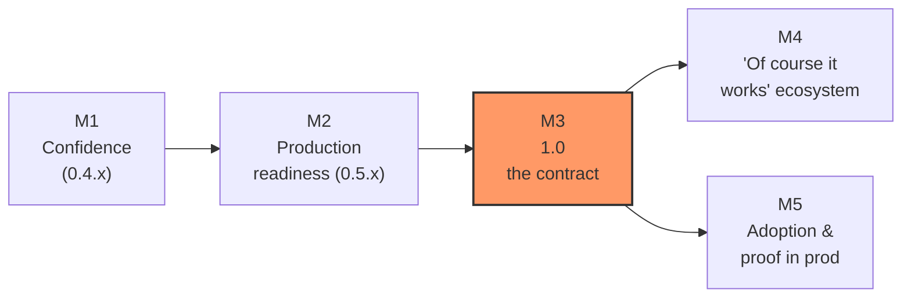

> 🇯🇵 日本語版: [ROADMAP.ja.md](ROADMAP.ja.md)

# homura roadmap

**North star: running Ruby on Cloudflare Workers should feel unremarkable.**

Today, "Ruby on the edge" reads like a stunt. The end state this roadmap
drives toward is the opposite of a stunt: a Ruby developer hears
"we run Sinatra on Cloudflare Workers in production" and shrugs —
*of course you do*. Every milestone below exists to close the gap between
"look, it works!" and "why wouldn't it work?".

The [README](README.md) currently carries a **"do not use in production
yet"** banner. This document is the plan for deleting that banner — and
for making its deletion boring.

---

## Where we are (2026-07 snapshot)

What the recent history says about the project:

- **Six gems ship from RubyGems** via GitHub Actions Trusted Publishing —
  `opal-homura` 1.8.3.rc1.5, `homura-runtime` 0.3.35, `sinatra-homura` 0.3.2,
  `sequel-d1` 0.3.1, `sinatra-inertia` 0.1.5, `sinatra-kagero` 1.0.2.
  No `path:` anywhere; [`examples/`](examples/) consume published gems only.
- **Seventeen standalone examples**, most deployed live at
  `*.kazu-san.workers.dev`, covering Rack, classic/modular Sinatra, D1 with
  and without Sequel, Email, OTP auth, Inertia, Hotwire, Phlex, Workers AI
  (chat / transcription / voice), Durable Objects, and the full
  [Kagero](gems/sinatra-kagero/) stack.
- **Kagero 1.0 landed**: a Ruby-way Inertia layer — Phlex pages, Literal
  props, `Kagero::Command` form modeling — with zero userland JavaScript.
- **The async story is invisible**: the auto-await build pass keeps user
  source sync-shaped; internals (`__await__` and friends) stay out of every
  public surface, by policy.
- **The pain is visible too**: shipping Phlex/Literal under Opal took
  homura-runtime 0.3.9 → 0.3.35 — 27 patch releases in a single day of
  publish-break-patch against the published-gem build. That loop is the
  single biggest thing standing between homura and "boring".

---

## M1 — Confidence: kill the publish-break-patch loop (`0.4.x`)

*Goal: a release is boring because everything it could break already ran in CI.*

The 0.3.9–0.3.35 burst proved the smoke suite (`npm test`) catches problems
**after** publishing, not before: the suite runs inside the monorepo, so it
never exercises what a user actually experiences — installing the packaged
gems from RubyGems and building a standalone app against them. Gem packaging
gaps and load-path assumptions only surfaced post-publish. And the loop was
expensive *by construction*: repo policy (rightly) bans `path:` gems in
examples and bans tag reuse, so the only environment that exercised the
published packaging was a real RubyGems release — one fix, one version bump,
27 times. The answer is to simulate the published environment in CI, not to
relax either policy. M1 turns the examples and smoke tests into a pre-release
gate instead of a post-release alarm.

- **Published-surface build matrix in CI.** Every PR builds every example
  against a locally-built `.gem` set (the same artifacts the release
  workflow would push), so "works from RubyGems" is verified without a
  round-trip through RubyGems. Tag pushes re-verify against the real
  registry before announcing.
- **Vendored-gem compat harness.** Sinatra / Rack / Sequel / Phlex /
  Literal / Zeitwerk versions are pinned in one manifest, with a scheduled
  job that trial-bumps each and runs the full suite —
  upstream drift becomes a failing PR, not a user bug report.
- **Opal fork strategy.** `opal-homura` is a patched fork on an rc version.
  Document the exact delta vs upstream Opal in
  [`docs/VENDOR_PATCHES.md`](docs/VENDOR_PATCHES.md), upstream what is
  upstreamable, and cut a non-rc release for what is not.
- **Ruby-shaped failures.** When a Worker crashes, the developer should see
  a Ruby backtrace pointing at `app.rb:12`, not a V8 stack into compiled
  output. Source-map-backed backtrace rewriting in `wrangler dev` first,
  production logs second.
- **`homura doctor`.** One command that checks Ruby/Node/wrangler versions,
  gem pin coherence, `wrangler.toml` shape, and binding declarations, and
  says exactly what is wrong.

**Exit criteria:** two consecutive gem releases with zero follow-up patch
release caused by the published build differing from the monorepo build.

---

## M2 — Production readiness (`0.5.x` → `1.0.0.rc`)

*Goal: the answer to "but can I actually operate this?" is a documented yes.*

- **Observability.** Structured request logging out of the box; an
  exception-reporting hook (pluggable — Sentry-compatible endpoint or
  Workers Analytics Engine); a documented `wrangler tail` workflow where
  Ruby exceptions arrive readable.
- **Numbers, published.** A benchmark page on the live site, regenerated in
  CI: cold-start time, bundle size per example, p50/p99 latency vs an
  equivalent plain-JS Worker. Ruby-on-Workers stops being a
  feelings-based conversation.
- **Bundle discipline.** A size budget per example enforced in CI, plus
  dead-code elimination for unused stdlib/vendored code paths. The smallest
  app (`todo-simple`) is the canary.
- **Security surface.** First-class encrypted session cookies, a CSRF
  helper for the form-post examples, and a "secrets live in wrangler, never
  in source" scaffold default — each with a documented recipe.
- **Operating guide.** One honest document: Workers CPU-time limits, bundle
  size limits, subrequest limits, D1 consistency model, what homura adds on
  top, and how each one bites and is mitigated. Production confidence comes
  from knowing the edges, not from hiding them.
- **App testing story.** `homura new` scaffolds a rack-test-style unit test
  that runs on CRuby (fast, no build) plus a one-command e2e task against
  `wrangler dev` — the pattern `auth-otp` already proves, made default.

**Exit criteria:** the [`site/`](site/) app and at least one
traffic-bearing real service run on the `1.0.0.rc` gems with logging,
error reporting, and the ops guide applied to themselves.

---

## M3 — 1.0: the contract

*Goal: the version number says what the README banner currently denies.*

- **Freeze the public surfaces**: CLI (`homura new` / `build` / `db:*`),
  scaffolder layout, binding helper names (`db`, `d1`, `kv`, `bucket`,
  `ai`, `send_email`, `durable_object`, …), the Kagero page/command API,
  and the `build/worker.entrypoint.mjs` contract.
- **Semver + deprecation policy.** Post-1.0, breaking changes get a major
  bump and a deprecation cycle. (Pre-1.0 stays intentionally ruthless, per
  repo policy — no compatibility shims on the way there.)
- **Lockstep 1.0** across homura-runtime / sinatra-homura / sequel-d1 /
  sinatra-inertia, with a single compatibility table: gem set ↔ supported
  `compatibility_date` range ↔ Ruby version.
- **Delete the banner.** Replace "do not use in production yet" with a
  supported-configuration statement. This is the whole point.

**Exit criteria:** the banner is gone, and removing it required no leap of
faith — every claim in the README is backed by CI or a live deployment.

---

## M4 — The "of course it works" ecosystem (post-1.0)

*Goal: the default answer to "does X work on homura?" is yes, verifiably.*

- **Gem compatibility gauge.** A live, generated page listing real gems
  exercised by the smoke suite (`jwt`, `faraday`, `octokit`, `phlex`,
  `literal`, `sequel`, …) with pass/fail per release. Growing this list is
  an explicit, ongoing workstream — every newly-green gem is a marginal
  "huh, it just works".
- **Full platform coverage.** Bindings already span D1 / KV / R2 / AI /
  Queues / Scheduled / Durable Objects / Vectorize / Email. Extend to
  Workflows, Hyperdrive (real Postgres through Sequel — the adapter
  architecture of `sequel-d1` generalizes), WebSockets on Durable Objects,
  rate limiting, and Browser Rendering — each with a deployed example,
  because [`examples/`](examples/) is the contract.
- **Kagero as the flagship app story.** Guides, richer validation
  ergonomics, partial-reload patterns, and a non-trivial reference app —
  the "Ruby all the way down, no userland JS" pitch deserves a showcase
  bigger than a todo list.
- **Agent workspace → real agent.** `agent-workspace` (Durable Objects +
  R2 shell) grows into the promised AI-agent example: long-running
  Ruby-orchestrated agents on the edge.

---

## M5 — Adoption: making it feel normal

*Goal: 当たり前感 — the sense that this is just how you deploy Ruby now.*

Normalcy is a distribution problem as much as an engineering one.

- **Docs that assume success.** Expand
  [homura.kazu-san.workers.dev/docs](https://homura.kazu-san.workers.dev/docs)
  from reference into guides: "Sinatra to the edge in 10 minutes", a
  cookbook per binding, "a Rails developer's map of Workers".
- **Zero-to-deployed templates.** Deploy-to-Cloudflare buttons and a
  starter gallery built from the examples, so the first success takes
  minutes and no cloning.
- **Proof in production.** Publish uptime/latency for the dogfood fleet at
  `*.kazu-san.workers.dev`, and case-study writeups of real services —
  claims with dashboards attached.
- **Tell the story.** Japanese and English writeups per milestone,
  benchmark posts, and RubyKaigi-adjacent visibility. The target reaction
  is not "wow" but "oh, neat, I'll try it this weekend".
- **Agent-native distribution.** Keep `llms.txt` and
  [`skills/homura-workers-gems/`](skills/homura-workers-gems/) current with
  each release — when a developer asks their AI assistant "can I run Ruby
  on Cloudflare?", the assistant answering "yes, use homura, here's the
  command" *is* the 当たり前感, mechanized.

---

## Non-goals

Guardrails carried over from the project's design policy:

- **No Rails port.** The surface is Ruby / Rack / Sinatra (+ Kagero above
  it). Depth over breadth.
- **No async ceremony, ever.** `__await__`-style internals stay out of user
  code, docs, and examples. If an idiom needs special spelling, that is a
  homura bug to absorb, not a convention to teach.
- **No compatibility shims pre-1.0.** Surfaces that miss the
  least-surprise bar get replaced, not aliased.
- **No SLA theater.** Live demos stay honest dogfooding fixtures until the
  observability and ops work in M2 makes real claims possible.

---

*This roadmap orders work by intent, not by calendar. Milestones overlap;
M5's storytelling starts whenever there is something true to say.*
